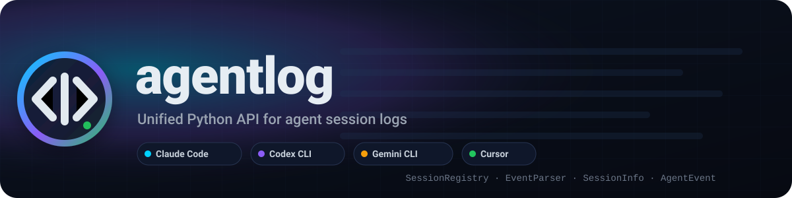
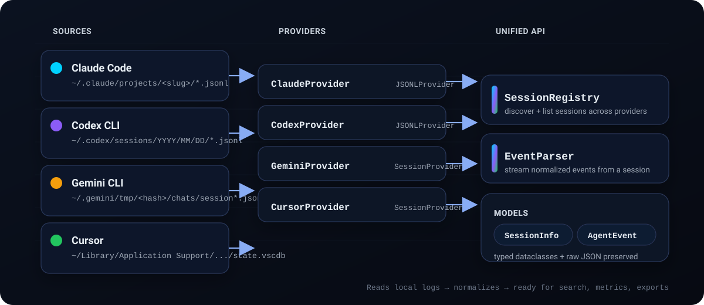
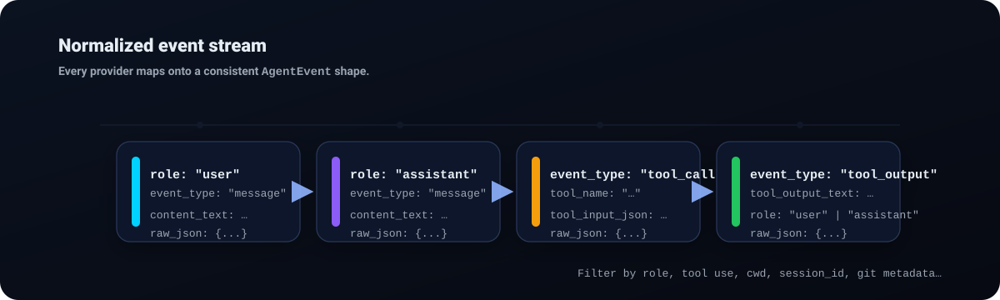

<p align="center">
  
</p>

Unified Python API for reading and normalizing agent session logs from **Claude Code**, **Codex CLI**, **Gemini CLI**, and **Cursor**.

## Why

If you bounce between agent tools, your local history ends up scattered across JSONL files and SQLite databases. `agentlog` gives you:

- **One schema**: `SessionInfo` + `AgentEvent` across all providers (raw JSON preserved).
- **Fast turn counts**: incremental, cached turn counting for JSONL logs.
- **Zero deps**: pure stdlib (Python `>=3.11`).
- **Project-aware sessions**: derives a project name by walking up to a `.git` root.
- **Lazy providers**: provider implementations load only when used.

## Architecture



## Install

```bash
uv pip install agentlog
# or
pip install agentlog
```

## Quickstart

```python
from datetime import datetime
from agentlog import SessionRegistry, EventParser

# List all sessions across all providers
registry = SessionRegistry()
sessions = list(registry.list_sessions())

# Sort by last activity (most recent first)
sessions.sort(key=lambda s: s.last_activity or datetime.min, reverse=True)

for session in sessions:
    print(f"{session.provider}: {session.session_id} ({session.turn_count} turns)")

# Parse events from the most recent session
if sessions:
    latest = sessions[0]
    # Reuse registry to avoid redundant discovery/config mismatches
    parser = EventParser(latest.provider, registry=registry)
    for event in parser.parse_session(latest):
        print(f"{event.role}: {event.content_text[:50]}")
```

## Event Stream



## Providers

| Provider | Source | Format |
|---|---|---|
| Claude Code | `~/.claude/projects/<slug>/*.jsonl` | JSONL |
| Codex CLI | `~/.codex/sessions/YYYY/MM/DD/*.jsonl` | JSONL |
| Gemini CLI | `~/.gemini/tmp/<hash>/chats/session*.json` | JSON |
| Cursor | `~/Library/Application Support/Cursor/User/globalStorage/state.vscdb` | SQLite |

## License

MIT
